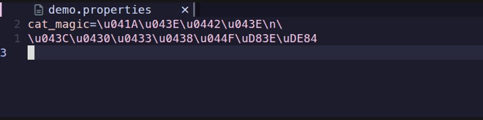

# jproperty.nvim

[](https://github.com/developersu/jproperty.nvim/actions/workflows/ci.yml)

A Neovim plugin for encoding and decoding Unicode escape sequences in Java `.properties` files.



Java `.properties` files store non-ASCII characters as `\uXXXX` escape sequences (e.g. `\u00E7`). This plugin provides two commands to toggle between the escaped and human-readable forms of the current buffer.

## Commands

| Command | Direction | Description |
|---|---|---|
| `:DecodeJavaProps` | `\uXXXX` → char | Replaces every `\uXXXX` escape with the actual character. Valid surrogate pairs (`\uD8xx\uDCxx`) are combined into a single supplementary character. |
| `:EncodeJavaProps` | char → `\uXXXX` | Replaces every character with a codepoint above U+007F with its `\uXXXX` escape. Supplementary characters (U+10000 and above) are written as surrogate pairs. |

Both commands operate on the entire current buffer. Each operation is a single change and can be undone with `u`.

## Installation

### Manual (no package manager)

Add the following to your `init.lua`:

```lua
vim.opt.rtp:prepend('/path-to-plugin/jproperty.nvim')
```

Or to your `init.vim`:

```vim
set runtimepath+=/path-to-plugin/jproperty.nvim
```

Then restart Neovim (or run `:source $MYVIMRC`).

### Using vim-plug

```vim
call plug#begin('~/.vim/plugged')
  Plug 'developersu/jproperty.nvim'
call plug#end()
```

### Using pack.nvim

```bash
git clone https://github.com/developersu/jproperty.nvim \
  ~/.local/share/nvim/pack/plugins/start/jproperty.nvim
```

### Using lazy.nvim

```lua
{ 'developersu/jproperty.nvim' }
```

No configuration is required. The commands are available as soon as the plugin directory is on `runtimepath`.

## Usage

1. Open a `.properties` file (or any file containing `\uXXXX` sequences).
2. Run the appropriate command:
    - `:DecodeJavaProps` — to make the file human-readable
    - `:EncodeJavaProps` — to restore the escaped form before saving

The file is modified in place. Use `u` to undo.

## Behaviour notes

- **`:EncodeJavaProps` escapes every character with cp > U+007F** — that is all non-ASCII characters, including the U+0080–U+00FF range. This matches the escaping convention of Java's `Properties.store()`.
- **Hex digits in generated escapes are uppercase** (`\u00E7`, `\uD83D`), which is the conventional style.
- **`:DecodeJavaProps` decodes lowercase `\uXXXX` only.** Uppercase `\UXXXX`, invalid hex (`\uG131`), and all other backslash sequences (`\n`, `\t`, `\\`, a trailing `\`, …) are left untouched.
- **Lone surrogates** (`\uD800`–`\uDFFF` not part of a valid pair) are left untouched by `:DecodeJavaProps` to avoid producing invalid UTF-8.
- **Malformed UTF-8**: an invalid lead byte is treated as a single-byte codepoint equal to its raw byte value, so e.g. a lone `0xC3` byte is encoded as `\u00C3`.
- **Round-trip**: `:DecodeJavaProps` → `:EncodeJavaProps` is identity for every character with cp > U+007F. Encoding an already-escaped file is a no-op.

## Tests

The plugin ships a self-contained headless test suite (no external dependencies). Run it locally:

```bash
./tests/run.sh
```

It unit-tests the line-level codec (`tests/codec_spec.lua`) and the buffer-level API against a real `.properties` file (`tests/buffer_spec.lua`, `testdata/`).

Continuous integration runs the same suite on every push and pull request via GitHub Actions (`.github/workflows/ci.yml`) against both Neovim nightly and the latest stable release.

## File layout

```
plugin/jproperty.vim          – command definitions (auto-loaded by Neovim)
lua/jproperty/init.lua        – buffer-level API (decode/encode of the whole buffer)
lua/jproperty/codec.lua       – pure single-line codec logic
tests/                        – headless test suite (run via tests/run.sh)
testdata/                     – real .properties file used by the tests
```

## License

MIT — see [LICENSE](LICENSE).

## Mirror

https://git.redrise.ru/desu/jproperty.nvim

